  

  

  

### hi, i'm lauren

I study computer science at Quinnipiac University (I transferred from the University of New Haven). I'm most interested in backend development, data and cloud. I've spent two summers as an engineering intern at Travelers, and this year I'm working on a document automation project with Sikorsky.

### what's floating around in my head

  

  
   
  

### where i've worked

**Engineering Development Program Intern** · Travelers, Hartford CT
 Jun 2026 – Aug 2026 · Personal Insurance, Data Distribution
- Came back for a second summer and took on bigger features across cloud infrastructure and backend microservices
- Built AI/ML-integrated services and grew our cloud tooling on AWS and Azure with Terraform, Python and Node.js
- Made a Claude plugin with 10 skills, connected to two MCP servers, to keep team documentation consistent

**Engineering Development Program Intern** · Travelers, Hartford CT
 Jun 2025 – Aug 2025 · Backend Engineering, Personal Insurance
- Built data pipelines, RESTful microservices and API integrations in Kotlin and Java
- Provisioned cloud infrastructure with Terraform on AWS/Azure and supported the team's CI/CD workflows
- Took part in InJam, Travelers' 3-day innovation event

**Technical Writing Peer Assistant (PITCH)** · University of New Haven
 Aug 2025 – May 2026
- Helped computing students write clearer technical documentation and reports

**Accounting Intern / Insurance Pre-Authorization Specialist** · MedFlight
 Jun 2022 – Dec 2024
- Handled invoice sorting, cost center assignment and financial data entry using Laserfiche and Excel

### things i've made

<table>
  <tr>
    <td width="50%" valign="top">
      <h4>Drawing & Data Sheet Automation</h4>
      Sikorsky × Quinnipiac · 2026 – now
        
      A Python pipeline that reads revision blocks, zone grids and GD&amp;T symbols out of engineering drawing PDFs and exports a clean revision history to Excel for the PLM system, replacing manual data entry. I trained random-forest and per-character classifiers to catch revision flags and read short codes, reaching 98.9% accuracy on held-out symbols.
        
      Python · OpenCV · Tesseract OCR · PyMuPDF · scikit-learn · pandas
    </td>
    <td width="50%" valign="top">
      <h4>Facial Recognition Therapist Chatbot</h4>
      Hack New Haven · March 2025
        
      Built in 24 hours with two teammates: a therapy website where a chatbot reads your facial expression and adjusts how it responds. Emotion analysis runs through the Google Gemini API, with MongoDB behind it. We won three categories: Best Game Design, Best Use of MongoDB and Best .Tech Domain Name.
        
      Gemini API · MongoDB · facial recognition
    </td>
  </tr>
  <tr>
    <td width="50%" valign="top">
      <h4><a href="https://github.com/llynch314/HarborSense">HarborSense</a></h4>
      A concept site for real-time coastal water monitoring: smart buoys and sensors that flag pollution early so communities can act before the damage sets in. It covers the tech, a live map mockup, market research and a user survey.
        
      HTML · CSS
    </td>
    <td width="50%" valign="top">
      <h4><a href="https://github.com/llynch314/2226Project">Sorting Benchmarks</a></h4>
      Six sorting algorithms (bubble, insertion, selection, shell, merge and quick) timed against each other on random, sorted and reversed datasets of 50k to 600k values, with the results graphed in Python.
        
      C++ · CMake · Python
    </td>
  </tr>
</table>

### outside of class

- **Hack New Haven:** organizer and marketing lead (2025 – 2026)
- **Rewriting the Code:** member since 2026, a community for women in tech

### school

**Quinnipiac University** · B.S. Computer Science · expected May 2027
 
**University of New Haven** · Computer Science · 2025 – 2026

 

  <picture>
    <source media="(prefers-color-scheme: dark)" srcset="https://raw.githubusercontent.com/llynch314/llynch314/output/snake-dark.svg">
    
  </picture>

  thanks for stopping by ~ say hi on <a href="https://www.linkedin.com/in/lauren-lynch-cs/">LinkedIn</a>

